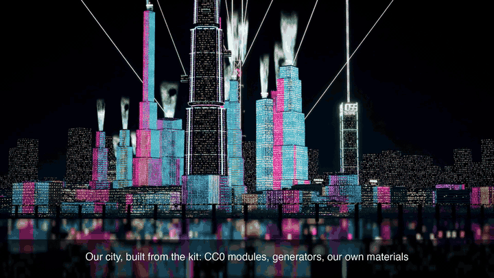

# Sovereign World Kit

**Build anything you're allowed to.** An open, agent-native kit for original 3D worlds. Every part is CC0, every output ships with a licence and a provenance record, and your agent refuses to rebuild other people's games. Web + Unreal. Built with Gamerplex.



## Install (Claude Code)
```
/plugin marketplace add gamerplex/sovereign-world-kit
/plugin install sovereign-world-kit@gamerplex
```
Then ask: **"build a rainy night street with Gamerplex, 24 bays"**.

Or clone and run it yourself (needs [Blender](https://www.blender.org/) 4.x and Python 3):
```bash
git clone https://github.com/gamerplex/sovereign-world-kit && cd sovereign-world-kit
python3 Tools/kit/cc0_fetch.py          # once: CC0 materials from ambientCG
Tools/kit/street.sh 24 12 --serve       # build a 24-bay street (seed 12) and open http://localhost:8765
```
Blender somewhere else? `BLENDER=/path/to/blender Tools/kit/street.sh …` · Neon-canyon street (stacked signs, skybridges): `DENSE=1 Tools/kit/street.sh 24 12 --serve`

## What you get
- `Saved/web/street.glb`: the street (two sides, shopfronts, upper floors, blade signs, lamps, road and sidewalks), Draco-compressed, ~9 MB at 16 bays. Loads in any glTF engine (three.js, Godot, Blender, Unreal).
- `Saved/web/street.provenance.json`: every input's file, SHA-256, source and licence, plus the generator version and settings. **The build refuses if any input has no known CC0 origin.**
- `Saved/web/LICENSE`: CC0 1.0 for the generated scene.
- `Saved/web/index.html`: a walkthrough (WASD + mouse; on phones drag to look and hold ▲).

## What's inside
| Path | What |
|---|---|
| `skills/build-street/` | the agent skill (also linked at `.claude/skills/` for cloned use) |
| `Tools/blender/kit/` | the generators: `facades.py` (module set), `street.py` (assembly), `street_build.py` (GLB + provenance gate) |
| `Imports/kit/` | the CC0 facade modules and sign atlases our generators made |
| `Tools/kit/cc0_fetch.py` | fetches the exact ambientCG sets the generator uses, each with a `source.json` record |
| `Tools/kit/web/` | the three.js walkthrough |

## Licensed by construction
- **In:** this kit's own generator output, CC0 materials (ambientCG), and photos you took yourself.
- **Refused:** other games' files or screenshots, known characters, brand logos and trademarks.
- **Out:** CC0 1.0 + a provenance record. Pure AI or procedural output generally isn't copyrightable (US Copyright Office, 2025), so CC0 is the honest default; what you design on top is yours.

## Roadmap
Our own city generator (districts, hills, stacked streets) → an Unreal plugin → a small CC0 gameplay pack → publishing to the Gamerplex arcade on Solana, where players pay cents and creators earn.

## Licence
Assets: CC0 1.0 (`LICENSE-ASSETS`). Code: MIT (`LICENSE`). Not legal advice: see `LEGAL.md`.
